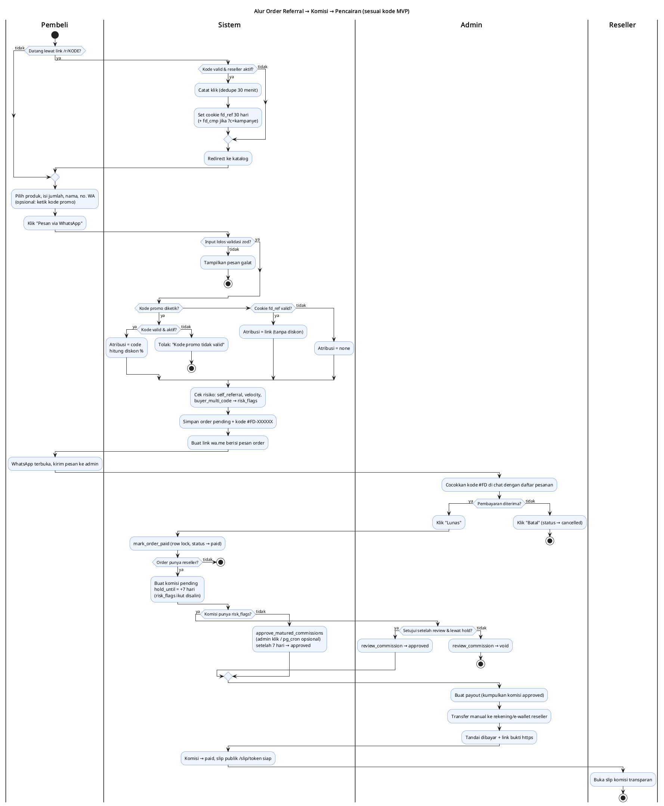
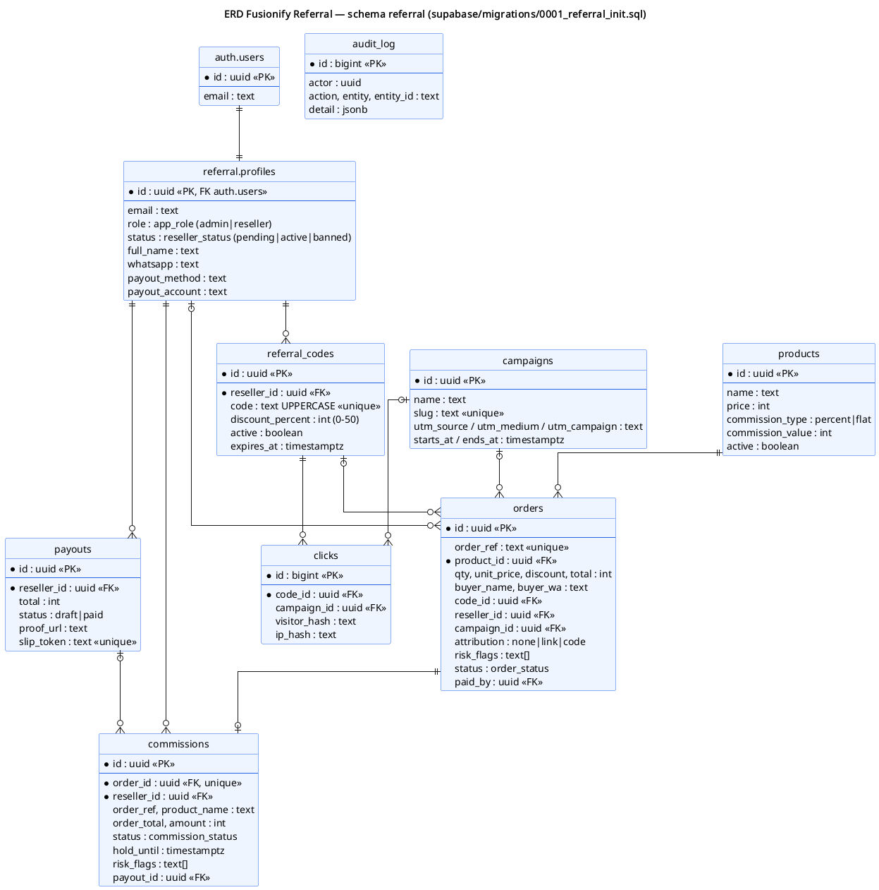

# Fusionify Referral

Sistem **referral & kode promo reseller** yang WA-first untuk toko produk digital, dibuat sebagai proyek portofolio dengan studi kasus PT Fusionify Digital Store. Pembeli tetap order lewat WhatsApp seperti biasa. Bedanya, setiap pesanan membawa kode `#FD-XXXXXX`, atribusi ke reseller tercatat otomatis, komisi dihitung oleh database, dan reseller bisa membuka slip komisinya sendiri.

> Status: MVP portofolio. Semua data di `seed.sql` diberi label **[DEMO]**. Produk dan angkanya bukan data asli Fusionify.



## Fitur
1. **Pendaftaran reseller → persetujuan admin**: setelah disetujui, admin membuatkan kode unik (misal `RINA10`), link `/r/RINA10`, dan QR.
2. **Katalog + "Pesan via WhatsApp"**: pembeli mengisi form, lalu `wa.me` terbuka dengan pesan yang sudah berisi produk, total, kode promo, dan **kode order `#FD-XXXXXX`**.
3. **Admin menandai lunas → komisi dibuat**: lewat RPC `mark_order_paid` yang atomic (row lock, jadi aman dari klik ganda).
4. **Dashboard reseller**: klik, order lunas, konversi, komisi tertahan, siap cair, sudah dibayar, dan riwayatnya.
5. **Pencairan**: admin membuat payout dari komisi yang sudah approved, transfer manual, lalu menyimpan link bukti.
6. **Peringkat bulanan**: hanya menampilkan nama depan.

**Fitur pembeda**
- **Kode order di pesan WA**: atribusi ikut terbawa ke chat, jadi admin tidak perlu menebak ini customer siapa.
- **Slip komisi transparan** di `/slip/<token acak 48 hex>`: bisa dibuka tanpa login, tanpa data pembeli, dan menyertakan link bukti transfer.
- **Kampanye UTM + kode promo**: tambahkan `?c=slug` atau `utm_campaign=slug` ke link, lalu lihat klik, order, dan omzet per kampanye. Kode promo memberi diskon untuk pembeli sekaligus komisi untuk reseller.

## Aturan bisnis
| Aturan | Implementasi |
|---|---|
| Atribusi | Kode promo yang **diketik** menang atas cookie link. Kalau tidak ada kode, dipakai **last-click** dari cookie `fd_ref` (berlaku 30 hari). |
| Anti atribusi ganda | `commissions.order_id` bersifat UNIQUE, jadi satu order maksimal punya satu komisi. |
| Komisi | `percent`: floor(total setelah diskon × %). `flat`: nilai × qty. Dihitung di SQL. |
| Masa hold | Komisi `pending` selama 7 hari, lalu `approved` lewat tombol admin atau pg_cron (opsional). |
| Anti-fraud dasar | Flag `self_referral` (WA pembeli = WA reseller), `velocity` (≥10 order/jam per kode), `buyer_multi_code`. Komisi yang ber-flag **tidak** di-approve otomatis dan masuk antrean review admin. |
| Refund | Komisi otomatis jadi `void` jika belum masuk payout. Kalau sudah masuk payout, ditolak dan harus ditangani manual. |
| Privasi | IP dan visitor disimpan sebagai hash SHA-256 dengan salt. Reseller tidak bisa membaca tabel `orders` (nama/WA pembeli). |

## Keamanan (RLS)
- Semua tabel ada di schema `referral` dengan RLS aktif; hak tabel diberikan eksplisit.
- **anon**: hanya bisa `select` produk aktif dan memanggil `get_slip(token)`.
- **reseller**: hanya bisa membaca profil, kode, klik, komisi, dan payout miliknya sendiri. Yang boleh diubah hanya kolom `full_name, whatsapp, payout_method, payout_account` (column grant), sehingga reseller tidak bisa mengubah `role` atau `status` sendiri.
- **admin**: akses dicek lewat `is_admin()`. Semua perubahan transaksi berjalan lewat RPC `security definer` yang memeriksa peran.
- `create_order` dan `log_click` hanya bisa dieksekusi **service_role**, yang dipanggil dari server action atau route handler. Service role key hanya ada di `lib/supabase/admin.ts` (`server-only`).

## Stack
Next.js 16.4.3 (App Router, `proxy.ts`, Cache Components), React 19.3.1, TypeScript 5.9, Tailwind CSS 4.3, Supabase (`@supabase/ssr` 0.12, Postgres + RLS), zod 4, qrcode, vitest 5. Butuh Node ≥ 24 (lihat `.nvmrc`).

## Setup lokal
```bash
nvm use            # Node 24
npm install
cp .env.example .env.local   # isi nilainya, JANGAN commit
```

### Berbagi project Supabase dengan umkm-auto-order (paket gratis)
Proyek ini sengaja numpang di project Supabase yang sama dengan umkm-auto-order supaya tetap gratis. Biar gak bentrok, **semua objek referral ada di schema `referral`** (tabel, enum, fungsi, policy). Schema `public` milik umkm sama sekali gak disentuh.
- Fungsi `referral.create_order` dan `public.create_order` (umkm) bisa hidup berdampingan karena beda schema.
- Ada satu trigger di `auth.users` (`referral_on_auth_user_created`), tapi trigger ini **hanya** membuat `referral.profiles` kalau metadata signup berisi `app = 'referral'` (dikirim oleh `/daftar`). Signup/user umkm gak kena apa-apa.
- Dashboard referral cuma bisa dipakai user yang punya baris di `referral.profiles`.
- Semua klien supabase-js memakai `db: { schema: 'referral' }` (lihat `lib/supabase/schema.ts`).

Langkah:
1. Di SQL Editor, jalankan berurutan: `supabase/migrations/0001_referral_init.sql`, `0002_referral_rpc.sql`, `0003_referral_cron.sql`.
2. **Wajib:** buka **Project Settings → Data API → Exposed schemas**, tambahkan `referral` (biarkan `public` tetap ada untuk umkm), lalu Save. Kalau langkah ini dilewati, semua query dari app bakal gagal dengan galat schema tidak diizinkan.
3. (Opsional, untuk demo) Buat user di **Authentication → Users** dengan email `demo.admin@example.com`, `demo.reseller1@example.com`, dan `demo.reseller2@example.com`, lalu jalankan `supabase/seed.sql`. Seed akan membuatkan profil referral untuk tiga email itu saja.
4. Untuk menjadikan akun yang sudah ada (misalnya akun admin umkm) sebagai admin referral:
   ```sql
   insert into referral.profiles (id, email, full_name, role, status)
   select id, email, 'Nama Kamu', 'admin', 'active' from auth.users where email = 'emailmu'
   on conflict (id) do update set role = 'admin', status = 'active';
   ```
5. `npm run dev` lalu buka http://localhost:3000

### Env vars
| Nama | Rahasia? | Keterangan |
|---|---|---|
| `NEXT_PUBLIC_SUPABASE_URL` | tidak | URL project |
| `NEXT_PUBLIC_SUPABASE_ANON_KEY` | tidak | anon/publishable key |
| `SUPABASE_SERVICE_ROLE_KEY` | **ya** | hanya di server |
| `FUSIONIFY_WHATSAPP_NUMBER` | tidak | `62xxxxxxxxxx`, tujuan wa.me |
| `NEXT_PUBLIC_SITE_URL` | tidak | untuk link dan QR reseller |
| `HASH_SALT` | **ya** | salt hash IP/visitor (`openssl rand -hex 32`) |

## Pengujian
```bash
npm run lint && npm run build && npm test   # 27 unit test (validasi, atribusi, pesan WA, komisi)
npm run test:sql                            # migrasi + seed + 30 cek alur/RLS + uji konkurensi di Postgres 17 lokal
bash supabase/tests/shared_project_check.sh /path/umkm-order   # bukti gak bentrok dengan umkm di 1 database
```
Uji konkurensi: 10 admin mengklik "Lunas" pada order yang sama secara paralel, hasilnya tepat 1 baris komisi.

## Struktur
```
app/            katalog (/), /r/[code], /login, /daftar, /dashboard, /admin/*, /slip/[token]
components/     UI (shell, form order, action form)
lib/            validasi zod, atribusi, pesan wa.me, format, hash, auth, klien supabase
supabase/       migrations/ (schema referral), seed.sql, tests/ (stub auth, run.sh, shared_project_check.sh)
diagrams/       activity-referral.puml/png, erd.puml/png
```



## Batasan (jujur)
- **Pembayaran tetap manual.** Tidak ada payment gateway, jadi status lunas bergantung pada admin. Payout juga ditransfer manual.
- **Atribusi lewat link butuh cookie.** Kalau pembeli pindah device atau memakai incognito, atribusi hilang kecuali pembeli mengetik kode promo.
- Satu order hanya berisi satu produk (belum ada keranjang).
- Deteksi fraud masih berbasis aturan sederhana. Belum ada device fingerprint, dan cek IP antara reseller dan pembeli belum dibuat.
- Rate limit hanya ada di `create_order` (≤20 order/10 menit per IP hash). Klik dibatasi lewat dedupe 30 menit per visitor.
- Statistik kampanye dan admin dihitung di aplikasi dengan batas 10.000 baris. Untuk volume besar, sebaiknya dipindah ke view/RPC agregat.
- Auto-approve terjadwal butuh pg_cron yang diaktifkan manual. Kalau tidak, admin menekan tombol "Approve komisi lewat masa hold".
- Kalau email sudah terdaftar di project (misalnya akun umkm), `/daftar` gak bikin profil referral baru; tambahkan lewat SQL di langkah 4.
- Belum diuji dengan Supabase Auth sungguhan atau secara end-to-end di browser. Tes SQL memakai stub `auth` lokal.
- Data rekening reseller disimpan apa adanya (tidak dienkripsi) dan dilindungi RLS. Untuk produksi, perlu kebijakan privasi (UU PDP).
- Tidak memakai skema multi-level, supaya tidak menyerupai skema piramida.

## Lisensi
MIT. Lihat [LICENSE](LICENSE).
